# DBMS Lab 2 Assignment

---

## Introduction
This repository contains the comprehensive documentation, SQL implementation scripts, and output screenshots for the Database Management Systems (DBMS) Lab 2 assignment. It covers advanced filtering, conditional selection, pattern matching, sorting, and projection operations using MySQL Workbench.

---

## Objectives
* To implement conditional data retrieval using `BETWEEN`, `IN`, and logical operators.
* To apply string pattern matching using the `LIKE` operator and wildcards.
* To extract specific date components using MySQL functions.
* To perform data projection, column aliasing, and basic arithmetic operations on table records.
* To verify database query execution and document outputs systematically.

---

## Question 1
### Problem Statement
Write a query to display the name (first_name, last_name) and salary for all employees whose salary is not in the range $10,000 through $15,000.

### Approach / Algorithm
1. Select the `first_name`, `last_name`, and `salary` columns from the `employee` table.
2. Apply the `NOT BETWEEN 10000 AND 15000` condition to filter salaries outside the specified range.
3. Execute the query and verify the output.

### Time & Space Complexity
Time Complexity: $O(N)$ linear scan over table rows. Space Complexity: $O(1)$ auxiliary space.

### Output
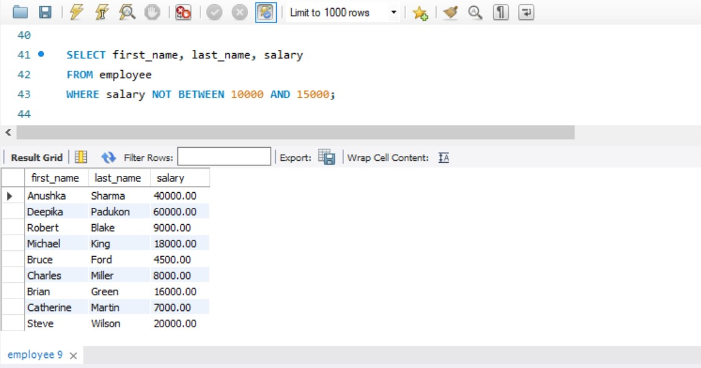

---

## Question 2
### Problem Statement
Write a query to display the name (first_name, last_name) and department ID of all employees in departments 30 or 100 in ascending order.

### Approach / Algorithm
1. Select `first_name`, `last_name`, and `department_id` from the `employee` table.
2. Use the condition `department_id = 30 OR department_id = 100`.
3. Order the resulting rows by `department_id` in ascending order using `ORDER BY department_id ASC`.

### Time & Space Complexity
Time Complexity: $O(N \log N)$ due to sorting overhead. Space Complexity: $O(N)$ for sorting buffers.

### Output
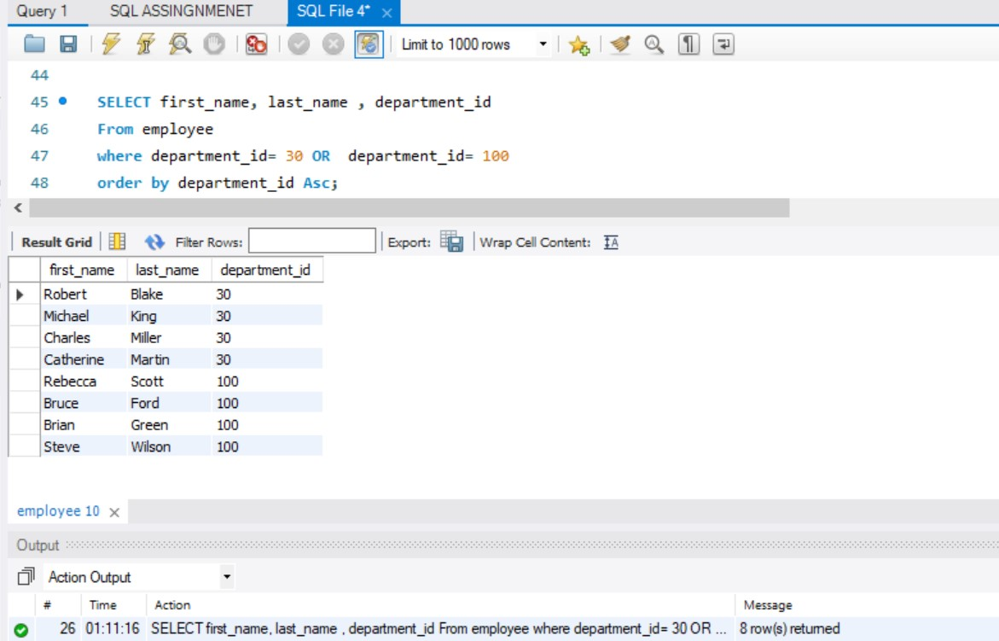

---

## Question 3
### Problem Statement
Write a query to display the name (first_name, last_name) and salary for all employees whose salary is not in the range $10,000 through $15,000 and are in department 30 or 100.

### Approach / Algorithm
1. Select `first_name`, `last_name`, and `salary` from the `employee` table.
2. Filter records using `salary NOT BETWEEN 10000 AND 15000` combined with `AND department_id IN (30, 100)`.
3. Execute and verify the result set.

### Time & Space Complexity
Time Complexity: $O(N)$. Space Complexity: $O(1)$.

### Output
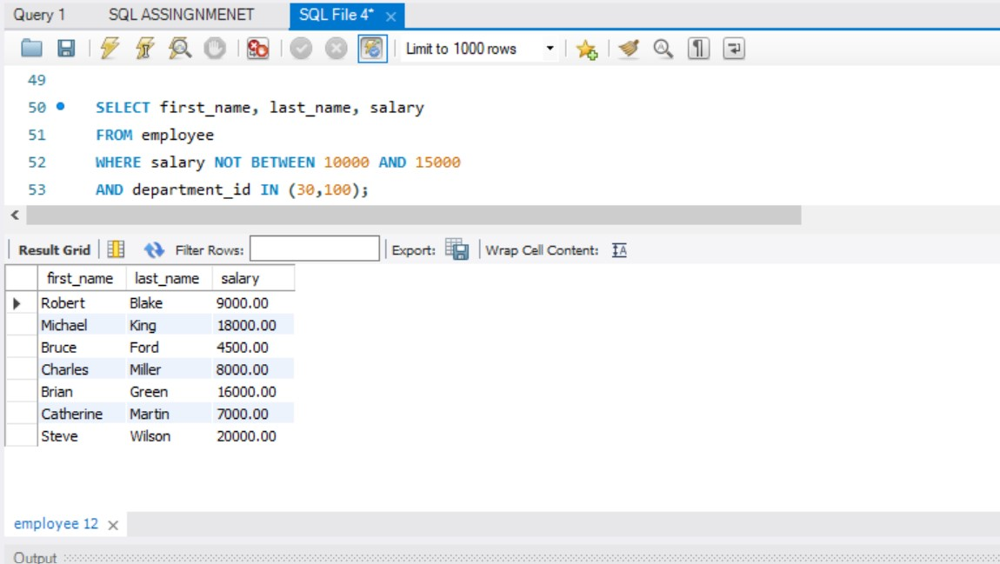

---

## Question 4
### Problem Statement
Write a query to display the name (first_name, last_name) and hire date for all employees who were hired in 1987.

### Approach / Algorithm
1. Select `first_name`, `last_name`, and `hire_date` from the `employee` table.
2. Extract the year from the hire date using `YEAR(hire_date) = 1987`.
3. Run the query and check the filtered records.

### Time & Space Complexity
Time Complexity: $O(N)$. Space Complexity: $O(1)$.

### Output
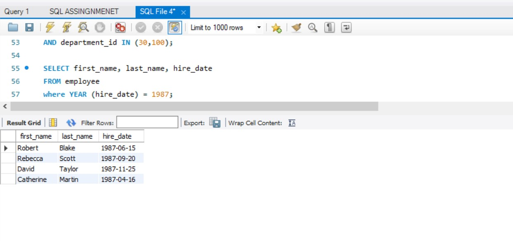

---

## Question 5
### Problem Statement
Write a query to display the first_name of all employees who have both "b" and "c" in their first name.

### Approach / Algorithm
1. Select `first_name` from the `employee` table.
2. Use wildcard pattern matching with `LIKE '%b%' AND LIKE '%c%'` to filter names containing both characters.
3. Execute the query and verify matching names.

### Time & Space Complexity
Time Complexity: $O(N \times M)$ where $M$ is string length. Space Complexity: $O(1)$.

### Output
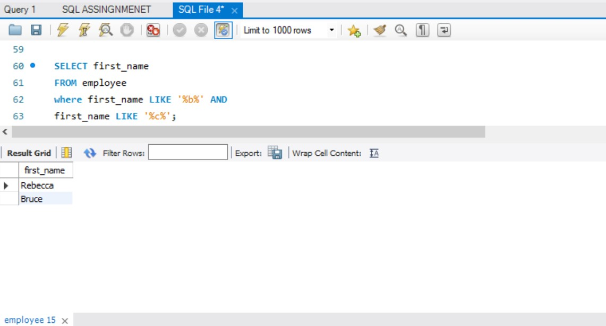

---

## Question 6
### Problem Statement
Write a query to display the last name, job, and salary for all employees whose job is that of a Programmer or a Shipping Clerk, and whose salary is not equal to $4,500, $10,000, or $15,000.

### Approach / Algorithm
1. Select `last_name`, `job_id`, and `salary` from the `employee` table.
2. Filter jobs using `job_id IN ('IT_PROG', 'SH_CLERK')`.
3. Exclude specific salary values using `salary NOT IN (4500, 10000, 15000)`.

### Time & Space Complexity
Time Complexity: $O(N)$. Space Complexity: $O(1)$.

### Output
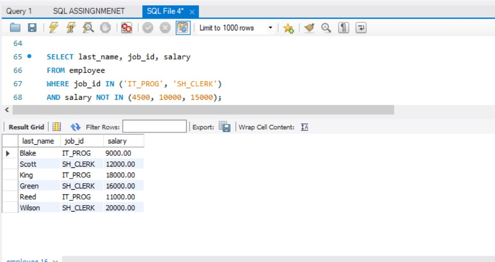

---

## Question 7
### Problem Statement
Write a query to display the last name of employees whose names have exactly 6 characters.

### Approach / Algorithm
1. Select `last_name` from the `employee` table.
2. Apply the pattern matching condition `LIKE '______'` (six underscores) to match names with exactly 6 characters.
3. Verify the output records.

### Time & Space Complexity
Time Complexity: $O(N)$. Space Complexity: $O(1)$.

### Output
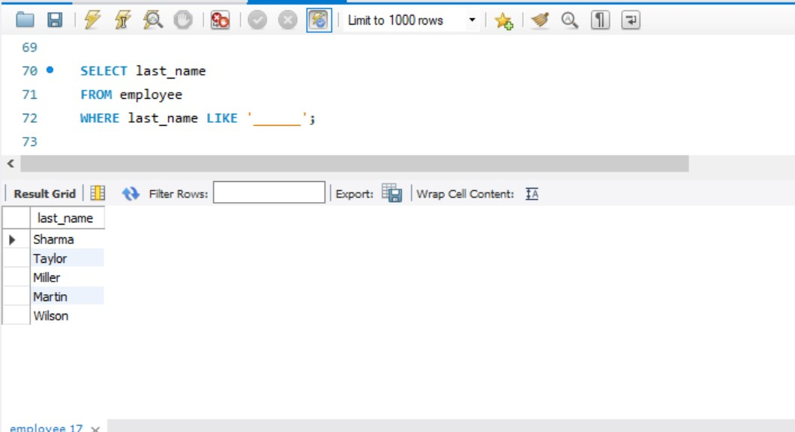

---

## Question 8
### Problem Statement
Write a query to display the last name of employees having 'e' as the third character.

### Approach / Algorithm
1. Select `last_name` from the `employee` table.
2. Use the pattern `LIKE '__e%'` where the first two characters are arbitrary followed by 'e'.
3. Run and validate the query.

### Time & Space Complexity
Time Complexity: $O(N)$. Space Complexity: $O(1)$.

### Output
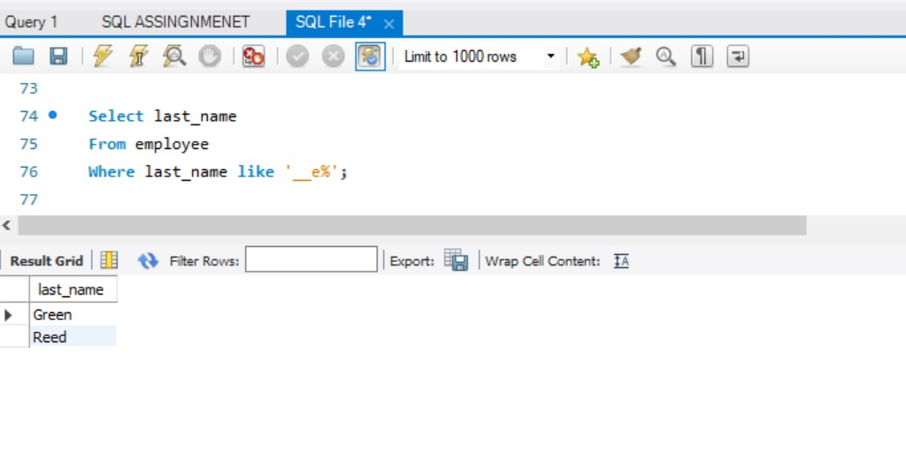

---

## Question 9
### Problem Statement
Write a query to display the jobs/designations available in the employees table.

### Approach / Algorithm
1. Select unique designations using `SELECT DISTINCT job_id` from the `employee` table.
2. Execute the query to filter out duplicate job titles.

### Time & Space Complexity
Time Complexity: $O(N \log N)$ or hash-based $O(N)$ for uniqueness check. Space Complexity: $O(N)$.

### Output
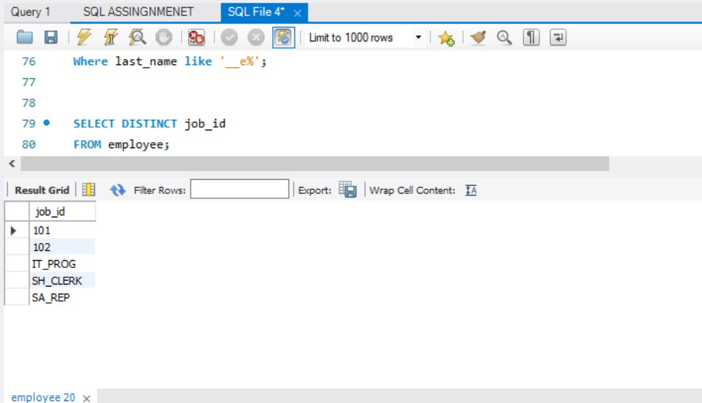

---

## Question 10
### Problem Statement
Write a query to display the name (first_name, last_name), salary and PF (15% of salary) of all employees.

### Approach / Algorithm
1. Select `first_name`, `last_name`, and `salary` from the `employee` table.
2. Calculate Provident Fund (PF) using the arithmetic expression `salary * 0.15 AS PF`.
3. Execute the projection query and verify calculations.

### Time & Space Complexity
Time Complexity: $O(N)$. Space Complexity: $O(1)$.

### Output
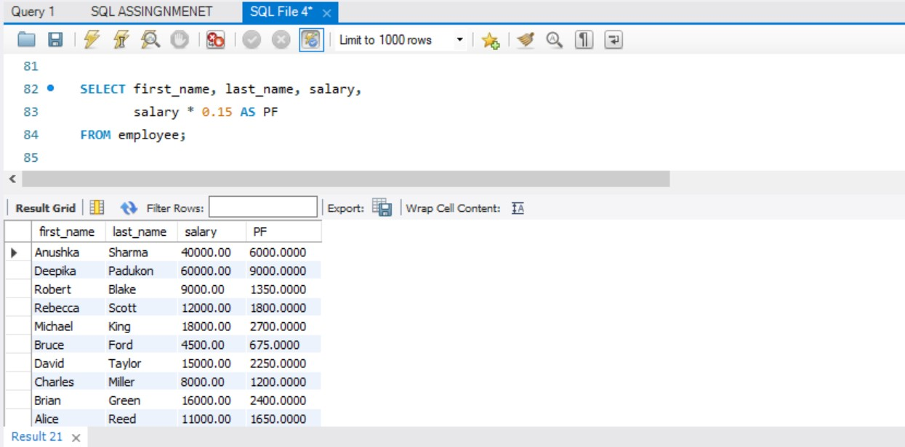

---

## Question 11
### Problem Statement
Write a query to select all record from employees where last name in 'BLAKE', 'SCOTT', 'KING' and 'FORD'.

### Approach / Algorithm
1. Select all columns using `SELECT *` from the `employee` table.
2. Filter rows where last names match the given list using `WHERE last_name IN ('BLAKE', 'SCOTT', 'KING', 'FORD')`.
3. Execute and verify the returned records.

### Time & Space Complexity
Time Complexity: $O(N)$. Space Complexity: $O(1)$.

### Output
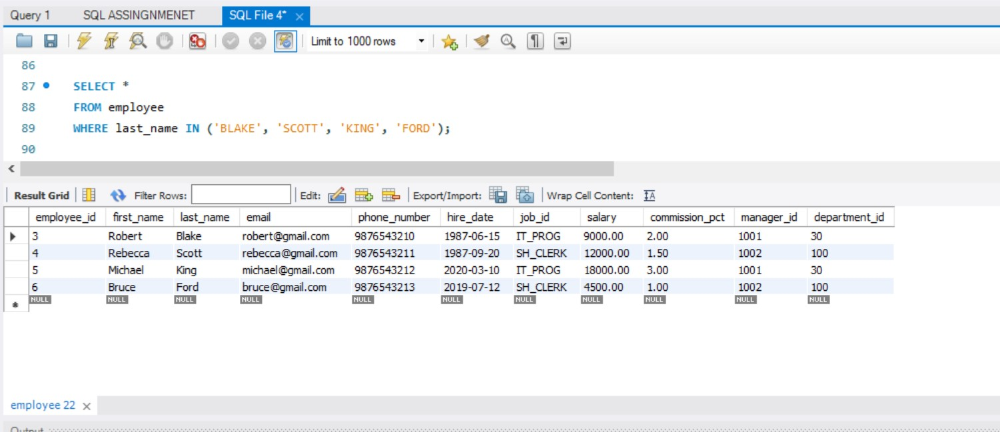

---

## Sample Output Verification Note
Output of each SQL statement was verified using the DBMS environment, and screenshots of the outputs are provided with the corresponding questions from Question 1 to 11.

---

## Learning Outcomes
* Gained hands-on proficiency in filtering data using range operators (`BETWEEN`), lists (`IN`), and pattern matching (`LIKE`).
* Mastered string manipulation and date function applications in MySQL.
* Learned how to perform column projections, arithmetic evaluations, and duplicate elimination (`DISTINCT`).
* Improved technical documentation skills by organizing lab assignments professionally using Markdown.

---

## Conclusion
The DBMS Lab 2 assignment was successfully executed, demonstrating practical mastery over conditional querying, data filtering, arithmetic projections, and database management using MySQL Workbench.
