# DBMS Lab 3 Assignment

---

## Introduction
This repository contains the comprehensive documentation, SQL implementation scripts, and output screenshots for the Database Management Systems (DBMS) Lab 3 assignment. It covers aggregate functions, grouping data using `GROUP BY`, conditional filtering with `HAVING`, and statistical analysis of employee records using MySQL Workbench.

---

## Objectives
* To compute aggregate statistics (Count, Sum, Min, Max, Average) on table records.
* To group data logically using the `GROUP BY` clause.
* To filter aggregated groups using the `HAVING` clause.
* To analyze departmental and job-wise salary distributions.
* To verify database query execution and document outputs systematically.

---

## Question 1
### Problem Statement
Write a query to list the number of jobs available in the employees table.

### Approach / Algorithm
1. Select the distinct job count using `COUNT(DISTINCT job_id)` from the `employee` table.
2. Alias the result column as `total_jobs` for clarity.
3. Execute the query and verify the output.

### Time & Space Complexity
Time Complexity: $O(N)$ for distinct scanning/hashing. Space Complexity: $O(N)$ for unique values storage.

### Output
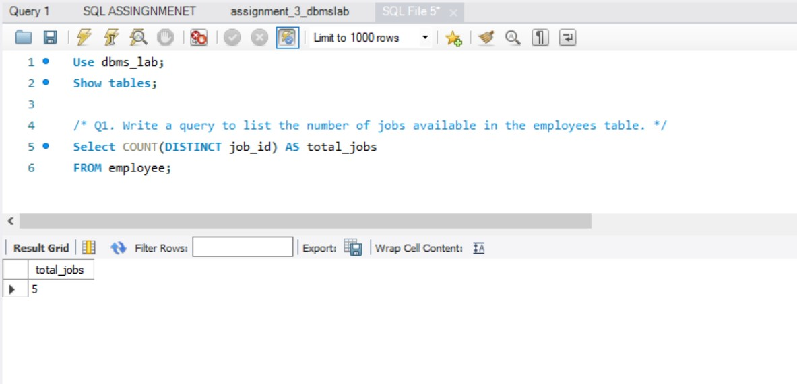

---

## Question 2
### Problem Statement
Write a query to get the total salaries payable to employees.

### Approach / Algorithm
1. Use the aggregate function `SUM(salary)` on the `employee` table to calculate total payroll.
2. Execute the query and verify the total sum.

### Time & Space Complexity
Time Complexity: $O(N)$. Space Complexity: $O(1)$.

### Output
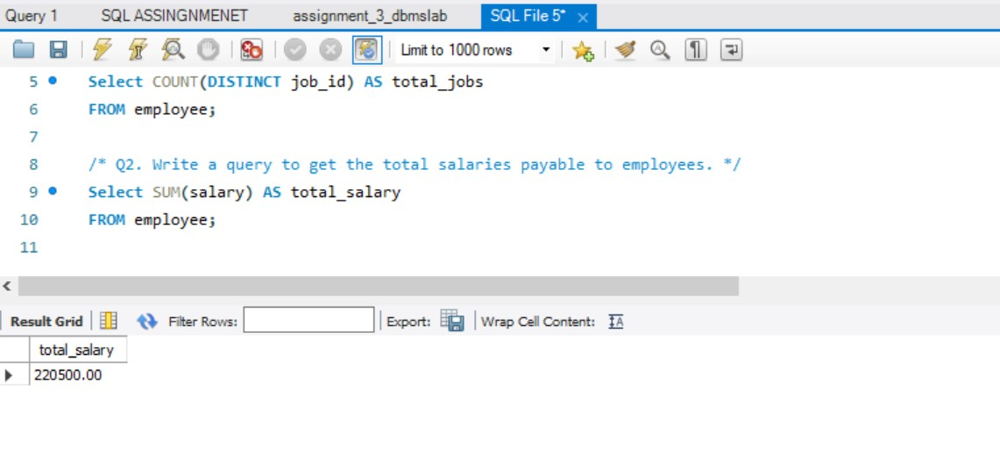

---

## Question 3
### Problem Statement
Write a query to get the minimum salary from employees table.

### Approach / Algorithm
1. Use the aggregate function `MIN(salary)` from the `employee` table.
2. Run the query and check the lowest salary value.

### Time & Space Complexity
Time Complexity: $O(N)$. Space Complexity: $O(1)$.

### Output
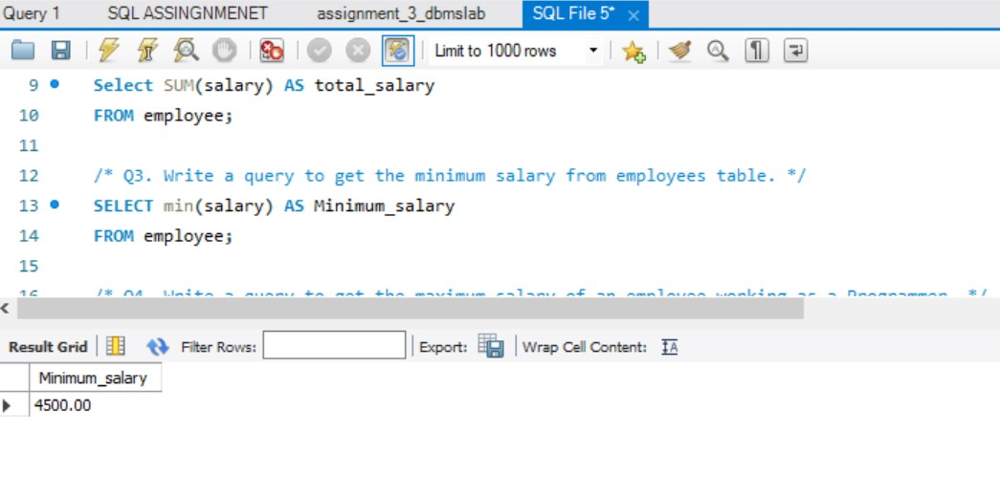

---

## Question 4
### Problem Statement
Write a query to get the maximum salary of an employee working as a Programmer.

### Approach / Algorithm
1. Filter records where `job_id = 'IT_PROG'` (or programmer designation).
2. Apply `MAX(salary)` to find the highest salary among programmers.
3. Execute and verify the result.

### Time & Space Complexity
Time Complexity: $O(N)$. Space Complexity: $O(1)$.

### Output
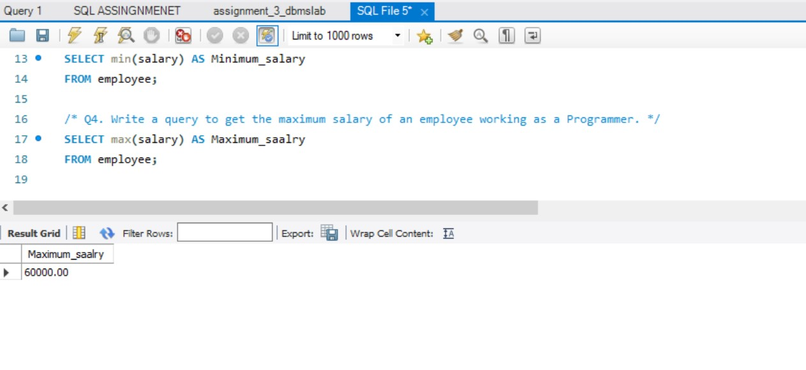

---

## Question 5
### Problem Statement
Write a query to get the average salary and number of employees working the department 90.

### Approach / Algorithm
1. Filter records where `department_id = 90`.
2. Apply `AVG(salary)` and `COUNT(*)` to get average salary and employee count.
3. Run the query and validate results.

### Time & Space Complexity
Time Complexity: $O(N)$. Space Complexity: $O(1)$.

### Output
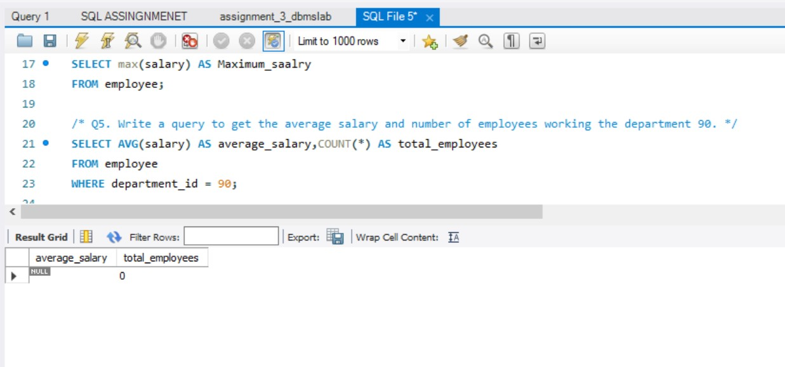

---

## Question 6
### Problem Statement
Write a query to get the highest, lowest, sum, and average salary of all employees.

### Approach / Algorithm
1. Combine multiple aggregate functions: `MAX(salary)`, `MIN(salary)`, `SUM(salary)`, and `AVG(salary)` on the `employee` table.
2. Execute the query to retrieve all statistics in a single result set.

### Time & Space Complexity
Time Complexity: $O(N)$. Space Complexity: $O(1)$.

### Output
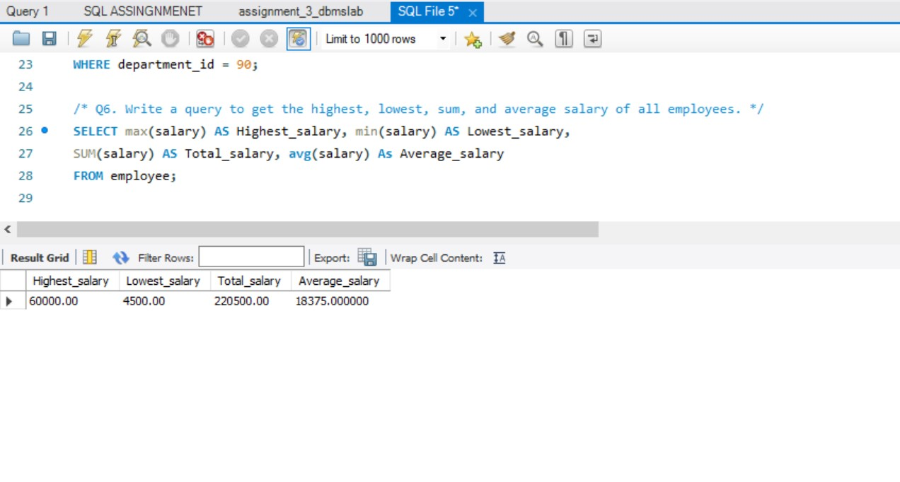

---

## Question 7
### Problem Statement
Write a query to get the number of employees with the same job.

### Approach / Algorithm
1. Select `job_id` and use `COUNT(*)` to count employees per job category.
2. Group the results using `GROUP BY job_id`.
3. Execute and verify the distribution.

### Time & Space Complexity
Time Complexity: $O(N \log N)$ or $O(N)$ with hashing. Space Complexity: $O(N)$.

### Output
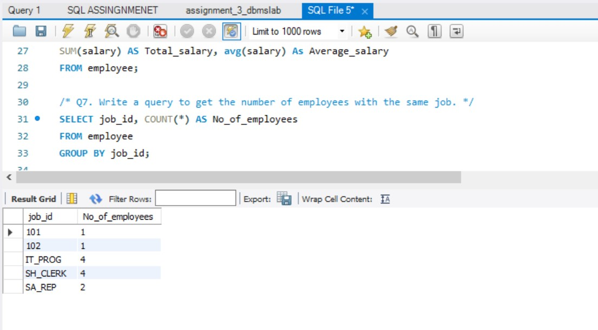

---

## Question 8
### Problem Statement
Write a query to get the difference between the highest and lowest salaries.

### Approach / Algorithm
1. Subtract the minimum salary from the maximum salary using the expression `MAX(salary) - MIN(salary)`.
2. Run the query and verify the calculated salary spread.

### Time & Space Complexity
Time Complexity: $O(N)$. Space Complexity: $O(1)$.

### Output
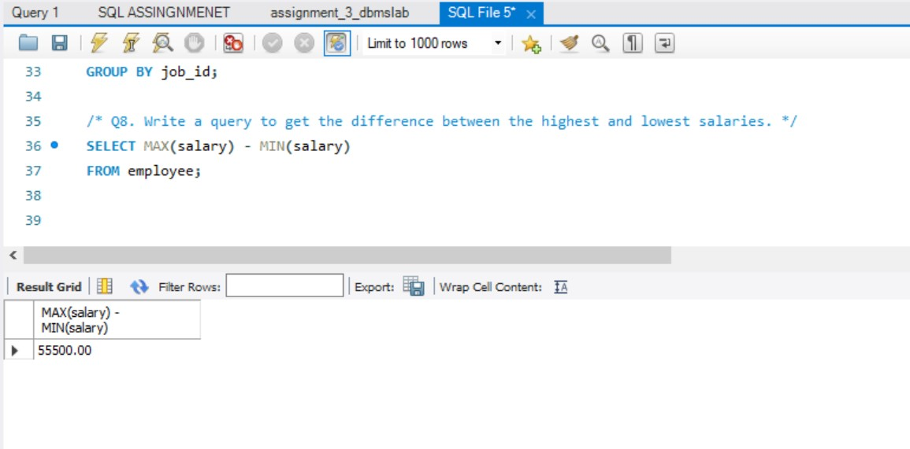

---

## Question 9
### Problem Statement
Write a query to find the manager ID and the salary of the lowest-paid employee for that manager.

### Approach / Algorithm
1. Select `manager_id` and apply `MIN(salary)` to find the minimum salary under each manager.
2. Group the records by `manager_id` using `GROUP BY manager_id`.
3. Execute and verify the output.

### Time & Space Complexity
Time Complexity: $O(N \log N)$. Space Complexity: $O(N)$.

### Output
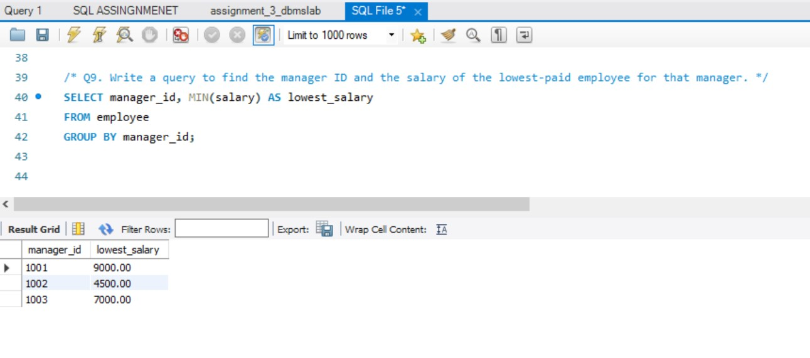

---

## Question 10
### Problem Statement
Write a query to get the department ID and the total salary payable in each department.

### Approach / Algorithm
1. Select `department_id` and compute `SUM(salary)`.
2. Group the result set by `department_id` using `GROUP BY department_id`.
3. Run the query and check departmental salary totals.

### Time & Space Complexity
Time Complexity: $O(N \log N)$. Space Complexity: $O(N)$.

### Output
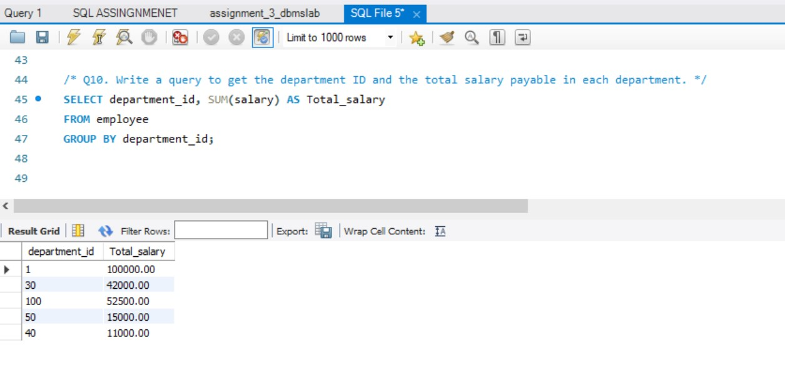

---

## Question 11
### Problem Statement
Write a query to get the average salary for each job ID excluding programmer.

### Approach / Algorithm
2. Group by `job_id` using `GROUP BY job_id`.
3. Exclude programmers using `WHERE job_id != 'IT_PROG'` (or equivalent).
4. Compute `AVG(salary)` for each remaining group and verify.

### Time & Space Complexity
Time Complexity: $O(N \log N)$. Space Complexity: $O(N)$.

### Output
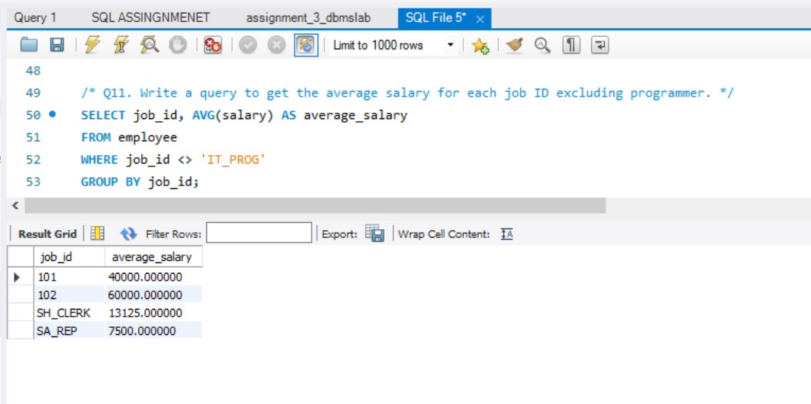

---

## Question 12
### Problem Statement
Write a query to get the total salary, maximum, minimum, average salary of employees (job ID wise), for department ID 90 only.

### Approach / Algorithm
1. Filter records for department 90 using `WHERE department_id = 90`.
2. Group by `job_id` using `GROUP BY job_id`.
3. Compute `SUM(salary)`, `MAX(salary)`, `MIN(salary)`, and `AVG(salary)` for each job group.

### Time & Space Complexity
Time Complexity: $O(N \log N)$. Space Complexity: $O(N)$.

### Output
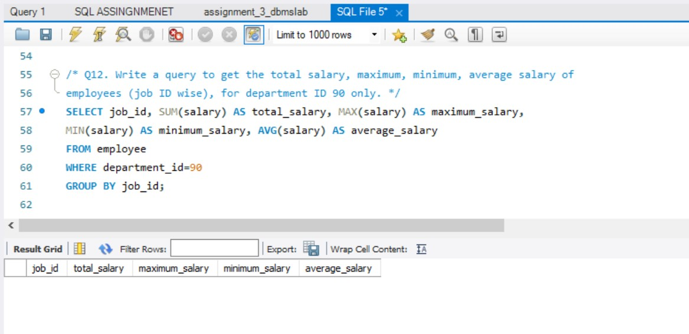

---

## Question 13
### Problem Statement
Write a query to get the job ID and maximum salary of the employees where maximum salary is greater than or equal to $4000.

### Approach / Algorithm
1. Select `job_id` and `MAX(salary)`, grouping by `job_id`.
2. Filter the aggregated groups using `HAVING MAX(salary) >= 4000`.
3. Execute and verify the filtered result set.

### Time & Space Complexity
Time Complexity: $O(N \log N)$. Space Complexity: $O(N)$.

### Output
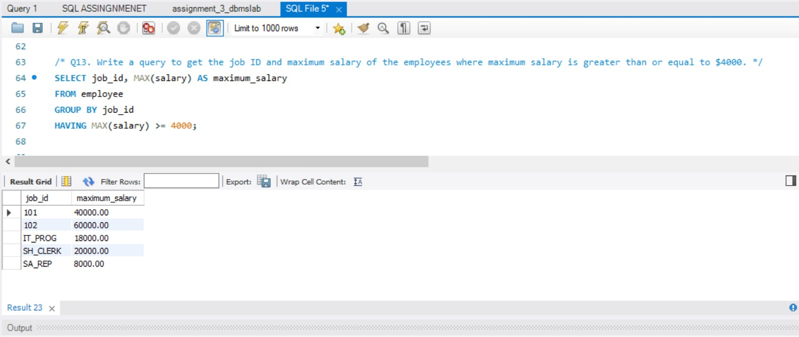

---

## Question 14
### Problem Statement
Write a query to get the average salary for all departments employing more than 10 employees.

### Approach / Algorithm
1. Select `department_id` and `AVG(salary)`, grouping by `department_id`.
2. Filter departments with more than 10 employees using `HAVING COUNT(*) > 10`.
3. Run the query and check the output.

### Time & Space Complexity
Time Complexity: $O(N \log N)$. Space Complexity: $O(N)$.

### Output
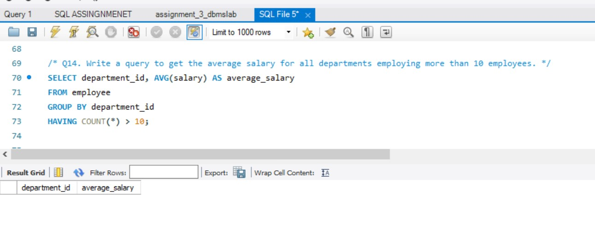

---

## Sample Output Verification Note
Output of each SQL statement was verified using the DBMS environment, and screenshots of the outputs are provided with the corresponding questions from Question 1 to 14.

---

## Learning Outcomes
* Gained hands-on proficiency in utilizing SQL aggregate functions (`COUNT`, `SUM`, `MIN`, `MAX`, `AVG`).
* Mastered data grouping using the `GROUP BY` clause and filtering groups with `HAVING`.
* Enhanced capability in writing complex analytical queries for database reporting.
* Improved technical documentation standards through structured Markdown files.

---

## Conclusion
The DBMS Lab 3 assignment was successfully executed, demonstrating practical mastery over aggregate functions, grouping, filtering, and comprehensive data summarization using MySQL Workbench.
